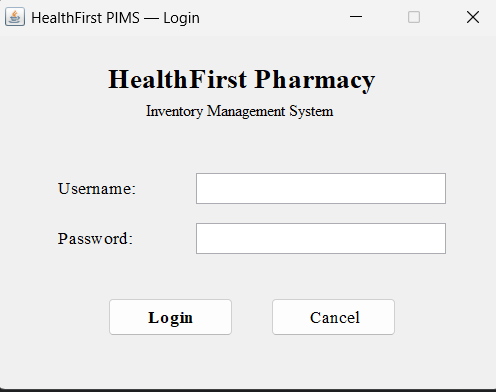
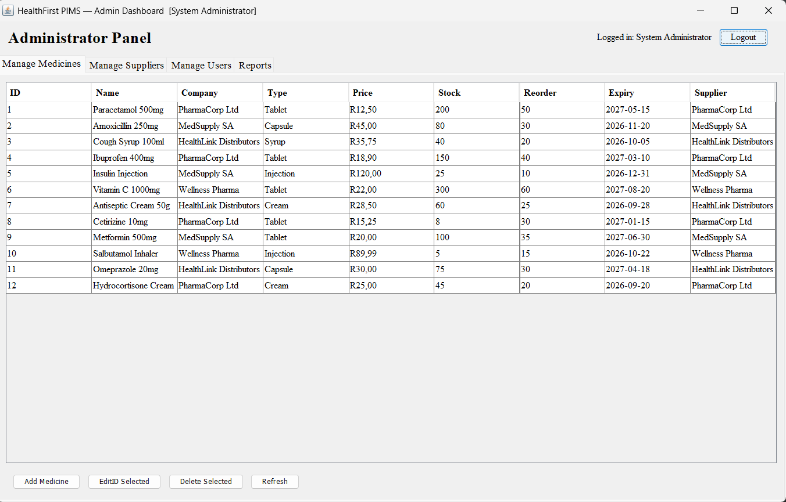
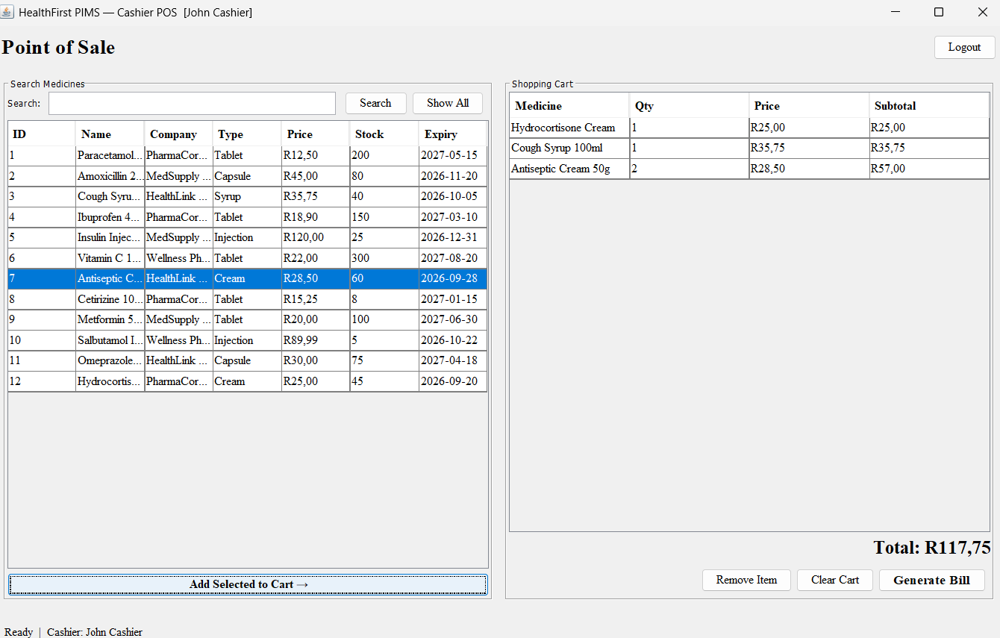
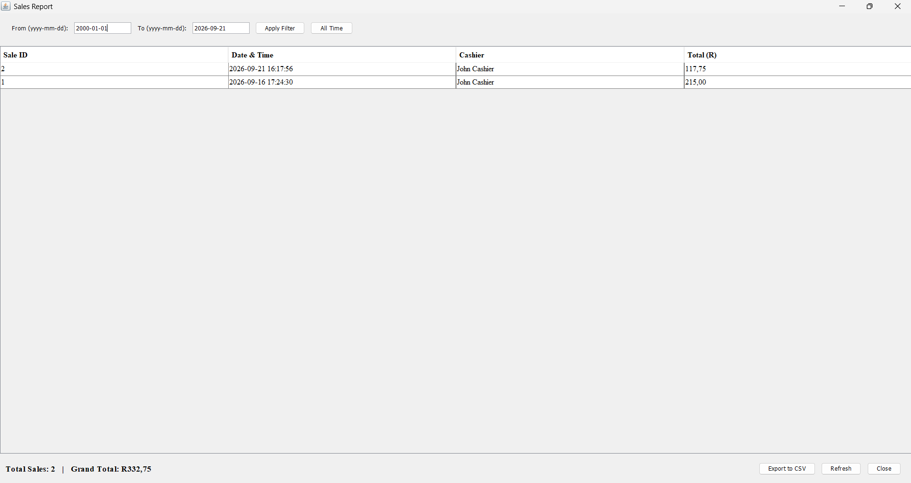
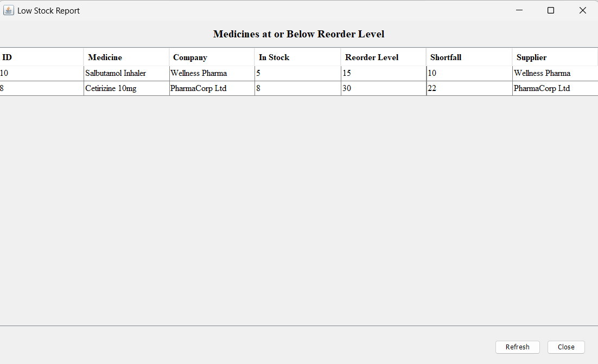

# HealthFirst Pharmacy Inventory Management System (PIMS)

A comprehensive desktop application built with Java (Swing) and MySQL to manage pharmacy inventory, process point-of-sale transactions, and generate business reports.

## Quick Start (How to Run)
Prerequisites: Java 8+ installed on your machine.
1. Database Setup: Run the database.sql file in MySQL Workbench to create the schema and sample data.
2. App Setup: Update the database credentials in src/pims_project/database/DBConnection.java to match your local MySQL username and password.
3. Run: Download the .jar file from the /executable folder and double-click to run, OR open the project in NetBeans and run LoginFrame.java.

###  Default Login Credentials
*   Admin: admin / admin123 (Full access to inventory, users, and reports)
*   Cashier: cashier / cash123 (Point-of-Sale and stock check)

##  Key Features
*   Role-Based Authentication: Secure login redirecting Admins and Cashiers to separate dashboards.
*   Point of Sale (POS): Fast cart system with real-time stock validation and receipt generation.
*   Inventory Management: Full CRUD (Create, Read, Update, Delete) for medicines and suppliers.
*   Business Reports: Generate Sales, Item-Wise, Low-Stock, and Expiry reports with CSV export capabilities.

##  Tech Stack & Architecture
*   Language: Java (JDK 11+)
*   GUI: Java Swing / AWT
*   Database: MySQL (JDBC)
*   Architecture: Data Access Object (DAO) pattern for clean separation of UI and database logic.

## Screenshots

### Authentication & Dashboards

### Point of Sale & Billing

### Business Reports

